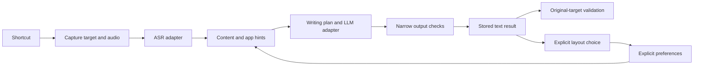

# Architecture

The Mac beta uses a Rust shared core, Tauri UI and native platform adapters. The `codex/windows` branch adds a first Windows candidate with WASAPI recording, Credential Manager, ordinary global shortcuts and a nonactivating result overlay. Windows UIA selection and validated original-target insertion remain pending; see [Windows scope](WINDOWS.md). This is the direct-download desktop client, without App Sandbox; store distribution needs separate capability and license review.

## Code map

| Location | Responsibility |
| --- | --- |
| `crates/vao-core` | Session transitions, translation boundaries, scene/preset selection, explicit layout preferences and narrow output checks |
| `desktop/src/main.rs` | Session orchestration, IPC, frozen settings/profile and result routing |
| `desktop/src/models.rs`, `trial.rs` | Bounded HTTP model adapters and opt-in hosted-trial routing |
| `desktop/src/store.rs` | SQLite settings, profile and bounded text history |
| `desktop/src/hotkeys.rs`, `native_keys.rs`, `local_capture.rs` | Shortcut parsing, registration rollback, Fn gestures and focused key entry |
| `platform/macos/Bridge.swift` | Captured AX targets, selection reading, clipboard and validated paste |
| `platform/macos/*.m`, `desktop/src/voice_bar.rs` | Permissions, local shortcut capture and nonactivating overlay |
| `ui` | Bundled HTML/CSS/JavaScript; presentation, localization and finite tutorials |

## Sessions and cancellation

`Session` moves from idle to preparing, listening, processing, ready, delivering and completed, with cancelled/failed terminal paths. A monotonically increasing session ID rejects stale responses. A delivery claim is single-use; uncertain receipt is not retried automatically. This implementation has no independent per-segment attempt-ID protocol.

At recording start, the host copies settings/profile and captures the target. Translation markers use sample positions. The recording buffer is capped at 120 seconds for all connections; custom models do not bypass that local memory bound. At most 12 translation toggles are accepted. Requests have a 10-second connect and 180-second total timeout; finishing a session has a 420-second processing budget. Cancellation drops in-flight request futures and prevents a late result from being published; it cannot guarantee that a remote provider stops computation.

Transcription is retained in runtime before refinement, so a model error can leave recoverable source text. Narrow date, quote, cancellation and explicit-three-step checks allow one repair on the same connection. Repeated failure preserves and marks the original `unrefined`; it cannot teach a preference. These checks do not prove full semantic equivalence and do not impose a manual-review gate on ordinary insertion.

## Context and explicit preferences

`WritingPlan` first resolves bounded content rules, then app-name/bundle hints. It chooses messages, actions, plans, technical records or documents. Explicit operational instructions remain tasks in social apps, and conversational messages remain conversational in agent apps. It does not inspect browser pages or scrape chat history. Presets enter model instructions; they are not canned text replacements. See [writing presets](WRITING_PRESETS.md).

The profile stores paragraph/numbered choices by chat, task or technical context. One remembered explicit choice activates or reverses a preference for later sessions. Single-use choices and generated output are not long-term evidence. Learning and personalization switches do not increase the learned-rule version. Disabling personalization retains data; deleting learning clears votes, active rules and undo snapshots. This is explicit preference adaptation, without background inference from arbitrary user edits.

Optional `task-apps.txt` in the app's local data directory accepts one app-name or bundle fragment per line, up to 40 lines. It is a local override, never source-release material.

## Models and credentials

ASR uses OpenAI-compatible multipart transcription; text uses non-streaming Chat Completions or the restricted Vao refinement contract. The latter cannot process translation or selected-text instructions. ASR and LLM choose custom/trial routing independently. An incomplete custom configuration fails instead of silently using a trial route. A configured backup LLM handles only transport errors, HTTP 429 and server errors.

All model and trial JSON bodies are bounded to 512 KiB. Redirects are disabled; remote URLs require HTTPS and cannot contain URL credentials, queries or fragments. Loopback HTTP is allowed. Keys are bound to the configured base URL and remain in Keychain; WebView state receives only presence flags. The public trial gateway URL is not secret. Per-installation enrollment needs consent; the server and its administration are outside this repository.

## Target delivery

The bundled Swift helper communicates through JSON stdin/stdout and keeps opaque AX element/window references in memory. A content SHA256 and caret/selection snapshot are calculated only for the explicitly captured editable field. Unselected contents and fingerprints are not stored or sent to model services.

For verifiable fields, the helper restores the original window/input after app switches, then checks its identity, contents and selection again before posting paste. Conflicts preserve the result with an overlay notice. Inputs without a reliable snapshot retain foreground/interaction checks. Composer discovery accepts only a unique supported candidate, without guessed click coordinates. The WeChat fallback still needs real-app compatibility work.

Selected-text questions return an answer in the overlay and clipboard, without replacing source text; edits can replace the selection. Empty speech and missing microphones use transient notices. The voice bar is a nonactivating native panel, supports dragging and stays inside the selected display's usable bounds. A posted paste is recorded as `paste_sent`, not verified receipt.

## UI, permissions and storage

Only bundled assets load under the Tauri Content Security Policy. Provider/user text is escaped before HTML insertion. The UI does not receive raw Keychain values. Native diagnostics are armed through explicit command-line flags and use separate SQLite state; see [testing](TESTING.md) before running them.

Normal shortcuts use system registration; Fn uses a native event tap. Bare Fn fires on release, and Fn chords suppress that bare action. Key entry in the focused settings window uses a 12-second local capture and does not need global access. Valid Fn settings can be saved before permission is available, but activation is reported as pending. Failed registration/persistence restores prior bindings where possible. Permission state comes from macOS, never a fabricated toggle.

SQLite keeps settings, bounded feedback evidence and at most 200 text results for seven days. Expired results are pruned on database/history access and rejected by ID. Audio stays in session memory. Deletion is logical application deletion, not a claim of secure erasure from OS backups or storage media. [Privacy](../PRIVACY.md) describes the full data flow.
