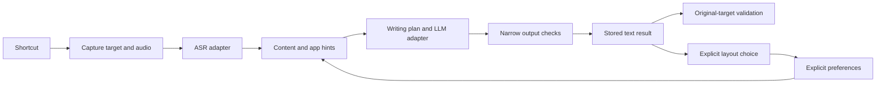

# Architecture

Vao uses a Rust core, Tauri UI and native platform adapters. Mac and Windows 0.2.1 are released through one download page, with separate source tags. The default branch and the detailed implementation below describe the Mac direct-download client, without App Sandbox; Windows source and platform differences are linked in [Windows build](WINDOWS_BUILD.md). Store distribution needs separate capability and license review.

## Code map

| Location | Responsibility |
| --- | --- |
| `crates/vao-core` | Session transitions, translation boundaries, scene/preset selection, explicit layout preferences and narrow output checks |
| `desktop/src/main.rs` | Session orchestration, IPC, frozen settings/profile and result routing |
| `desktop/src/models.rs`, `trial.rs` | Bounded HTTP model adapters and opt-in hosted-trial routing |
| `desktop/src/store.rs` | SQLite settings, profile and bounded text history |
| `desktop/src/hotkeys.rs`, `native_keys.rs`, `local_capture.rs` | Shortcut parsing, registration rollback, Fn gestures and focused key entry |
| `platform/macos/Bridge.swift` | Captured AX targets, selection reading, clipboard and validated paste |
| `platform/macos/*.m`, `desktop/src/voice_bar.rs` | Permissions, local shortcut capture and nonactivating overlay |
| `ui` | Bundled HTML/CSS/JavaScript; presentation, localization and finite tutorials |

## Sessions and cancellation

`Session` moves from idle to preparing, listening, processing, ready, delivering and completed, with cancelled/failed terminal paths. A monotonically increasing session ID rejects stale responses. A delivery claim is single-use; uncertain receipt is not retried automatically. This implementation has no independent per-segment attempt-ID protocol.

At recording start, the host copies settings/profile and captures the target. Translation markers use sample positions. Audio is resampled continuously to 16kHz PCM16 and sent through a bounded writer queue to an owner-only, immediately unlinked session file. There is no fixed 120-second recording cutoff; final ASR uses at most 90-second windows with quiet-boundary selection and a short overlap. Queue or I/O errors preserve the captured prefix and mark the result as interrupted. At most 12 translation toggles are accepted. Requests have a 10-second connect and 180-second total timeout; finishing has a duration-adjusted processing budget (420 seconds plus twice the audio duration, capped at one hour). Cancellation drops in-flight request futures and prevents a late result from being published; it cannot guarantee that a remote provider stops computation.

Transcription is retained in runtime before refinement, so a model error can leave recoverable source text. Narrow date, quote, cancellation and explicit-three-step checks allow one repair on the same connection. Repeated failure preserves and marks the original `unrefined`; it cannot teach a preference. These checks do not prove full semantic equivalence and do not impose a manual-review gate on ordinary insertion.

## Context and explicit preferences

`WritingPlan` first resolves bounded content rules, then app-name/bundle hints. It chooses messages, actions, plans, technical records or documents. Explicit operational instructions remain tasks in social apps, and conversational messages remain conversational in agent apps. It does not scrape chat history. Optional bounded context from the original window is described below. Presets enter model instructions; they are not canned text replacements. See [writing presets](WRITING_PRESETS.md).

The profile stores paragraph/numbered choices by chat, task or technical context. One remembered explicit choice activates or reverses a preference for later sessions. Single-use choices and generated output are not long-term evidence. Learning and personalization switches do not increase the learned-rule version. Disabling personalization retains data; deleting learning clears votes, active rules and undo snapshots. This is explicit preference adaptation, without background inference from arbitrary user edits.

Optional `task-apps.txt` in the app's local data directory accepts one app-name or bundle fragment per line, up to 40 lines. It is a local override, never source-release material.

## Models and credentials

ASR uses OpenAI-compatible multipart transcription; text uses non-streaming Chat Completions or the restricted Vao refinement contract. The latter is a legacy compatibility API: POST `/refine` with `text` and `preferences`, returning JSON `text`. It is not an alternate mode for generic Chat Completions servers, and cannot process translation, selected-text instructions or input context. The UI labels this scope explicitly; an unsupported route reports a protocol-specific error without silently trying another protocol. ASR and LLM choose custom/trial routing independently. An incomplete custom configuration fails instead of silently using a trial route. A configured backup LLM handles only transport errors, HTTP 429 and server errors.

All model and trial JSON bodies are bounded to 512 KiB. Redirects are disabled; remote URLs require HTTPS and cannot contain URL credentials, queries or fragments. Loopback HTTP is allowed. Keys are bound to the configured base URL and remain in Keychain; WebView state receives only presence flags. The public trial gateway URL is not secret. Per-installation enrollment needs consent; the deployed server, credentials and administration are outside this repository. Generic selection-policy adapters are provided in `scripts/gateway/` without a complete hosted-service deployment.

## Target delivery

The bundled Swift helper communicates through JSON stdin/stdout and keeps opaque AX element/window references in memory. A content SHA256 and caret/selection snapshot are calculated only for the explicitly captured editable field. Fingerprints are not stored or sent to model services. Unselected contents are sent only as bounded, explicitly enabled ordinary-dictation context, described below.

For verifiable fields, the helper restores the original window/input after app switches, then checks its identity, contents and selection again before posting paste. Conflicts preserve the result with an overlay notice. Inputs without a reliable snapshot retain foreground/interaction checks. Composer discovery accepts only a unique supported candidate, without guessed click coordinates. The WeChat fallback still needs real-app compatibility work.

Selected-text questions return an answer in the overlay and clipboard, without replacing source text; edits can replace the selection. Empty speech and missing microphones use transient notices. The voice bar is a nonactivating native panel, supports dragging and stays inside the selected display's usable bounds. A posted paste is recorded as `paste_sent`, not verified receipt.

## UI, permissions and storage

Only bundled assets load under the Tauri Content Security Policy. Provider/user text is escaped before HTML insertion. The UI does not receive raw Keychain values. Native diagnostics are armed through explicit command-line flags and use separate SQLite state; see [testing](TESTING.md) before running them.

Normal shortcuts use system registration; Fn uses a native event tap. Bare Fn fires on release, and Fn chords suppress that bare action. Key entry in the focused settings window uses a 12-second local capture and does not need global access. Valid Fn settings can be saved before permission is available, but activation is reported as pending. Failed registration/persistence restores prior bindings where possible. Permission state comes from macOS, never a fabricated toggle.

SQLite keeps settings, bounded feedback evidence and at most 200 text results for seven days. Expired results are pruned on database/history access and rejected by ID. Audio is held in an immediately unlinked session buffer until processing/cancellation releases it. Deletion is logical application deletion, not a claim of secure erasure from OS backups or storage media. [Privacy](../PRIVACY.md) describes the full data flow.

## Optional input enhancements

All enhancement options are off by default. File-window preview uses one in-flight request, a four-second scheduling delay, at most the latest twelve seconds of audio and a twelve-second request deadline. Windows replace each other; file-preview text never contributes to final output, history or learning. Stop/cancel changes the session phase, drops the preview request future and rejects late writes. Remote work may continue after cancellation. Two consecutive preview errors fall back to final-only transcription.

Input context is ordinary-dictation-only. A bounded native worker uses the captured AX element and original content/caret snapshot, with a separate reply pipe from the serialized delivery RPC. A 700ms host deadline and native AX deadlines limit work; request expiry prevents a queued request from starting later. Context goes only into the user JSON data of compatible text requests, including repair and configured backup, never into transcript/preferences or ASR. The restricted refine protocol omits it. Only context-free metadata can reach general diagnostics; raw snippets are session memory. Selection and translation keep existing semantics.

The `openai_realtime` ASR protocol supports compatible transcription services. With preview enabled it opens a public transcription WebSocket session, converts 16 kHz samples to 24 kHz PCM16 and commits bounded turns. Confirmed items are ordered by committed sample coverage; duplicates are idempotent, conflicting or incomplete results fail closed. Only ordinary unmarked dictation without capture warnings reuses a complete final transcript. Other operations, disabled preview and failures use file transcription on the same connection. Credential reuse is session-local. Dropped result receivers or cancelled sessions stop the realtime future. No private provider endpoint is used.

Expanded context depends on the input-context option and adds bounded original-window static text, title and domain; no full URLs or other windows. Native reads stay under node/depth/time limits and recheck the captured input. The Rust boundary revalidates scalar/byte budgets. Reference-copy checks run before final acceptance and after one repair, reverting to spoken source on repeated leakage.

`dictionary_io.rs` imports bounded UTF-8 TXT/JSON after native file selection, validates the full list, then merges into the latest saved settings. Failed/cancelled imports leave data unchanged. Export snapshots saved terms only and atomically replaces a selected TXT/JSON file. Model secrets and histories are never included.

Free-service authorization remains separate from use accounting. The separately operated gateway no longer enforces expiry, per-device/global daily usage or enrollment quotas. New clients use the unlimited status flag; legacy numeric fields are compatibility placeholders. Queues, revocation and physical inference bounds remain.

## Windows implementation

Windows release source is on tag `windows-v0.2.1`, with ongoing work on `codex/windows`. Its native adapters use Windows capture, UI Automation, Credential Manager, clipboard ownership checks, a nonactivating overlay, system shortcuts and an NSIS installer. Ordinary dictation defaults to the current caret when ready; returning to the original target is optional. Windows does not use the Mac Swift helper or hardware Fn event tap. Its expanded context contains only the starting window title, not Mac-style nearby static text or domains. See the [Windows guide](WINDOWS.md), [build notes](WINDOWS_BUILD.md) and [privacy details](../PRIVACY.md).
